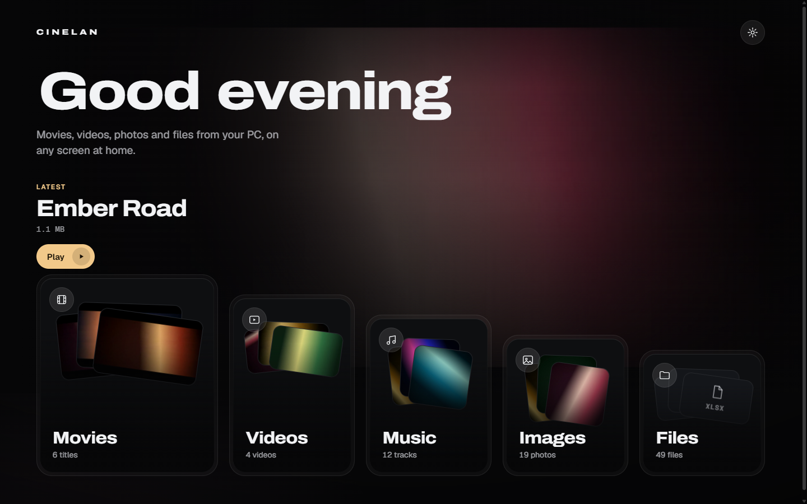

  

  Cinelan turns the PC that holds your library into a private streaming room for every screen on your wifi. 
  One Python file, no accounts, nothing to install on the other devices.

  

<h2></h2>

You need **Python 3.8+** and **ffmpeg** (for thumbnails, MKV and subtitles): `winget install Gyan.FFmpeg`, `brew install ffmpeg` or `sudo apt install ffmpeg`.

1. Run `python start.py` (double-click it on Windows) and pick the folder that holds your media.
2. Open the link it prints on any device on the same wifi.

  

It uses port 6767, or a free one if that is taken. To skip the folder window, run `python start.py "D:\Movies"`. There is no login, so anyone on your wifi with the link can see that folder.

<h2></h2>

| Room | What lands there |
| --- | --- |
| **Movies** | Every `.mkv` file |
| **Videos** | MP4, MOV, WEBM, AVI and other video files |
| **Music** | MP3, FLAC, WAV, M4A, OGG, Opus and more, grouped into albums |
| **Images** | Photos, with a full-screen viewer |
| **Files** | Everything else. Tap a file to download it |

<h2></h2>

<table>
  <tr>
    <td width="50%"></td>
    <td width="50%"></td>
  </tr>
</table>

Music keeps playing while you browse, from a dock at the bottom of every page. Artwork and tags come from the files, and the Now Playing sheet has shuffle, repeat and an Up next queue. On Android it keeps playing with the screen off. Starting a movie pauses it.

<h2></h2>

  

- **Audio and subtitles:** pick any audio track, and load subtitles from inside the file, an `.srt` or `.vtt` beside it, or your device.
- **Zoom:** Fit, Immersive, Fill or Stretch to deal with black bars. Pinch to zoom on a phone.
- **Ambient light:** the film lights the room around it. Choose Spill, Mirror, Edge, Theatre, Vivid or your own settings from the Zoom button, then Ambient light.
- It also remembers where you stopped, so Resume picks up right there.

<h2></h2>

- **TV:** open the link in the TV browser. The arrow keys move, OK selects and Back goes back. TVs are detected automatically; add `?tv=1` to the link if yours is not.
- **Android:** double-tap the sides of the picture to skip 10 seconds, pinch to zoom, and swipe photos to browse.
- **iPhone:** open the link in Safari, then Share and Add to Home Screen.

<h2></h2>

| Problem | Fix |
| --- | --- |
| A TV or phone cannot open the link | Use the same wifi as the PC, and allow Python through the Windows firewall for private networks. |
| The link stopped working | The PC's address can change. Use the link `start.py` prints each time. |
| No thumbnails, MKV or subtitles | Install ffmpeg and restart `start.py`. |
| Black picture with sound | Turn on the lightning button in the player (compatibility mode). |
| Nothing animates | Windows has "Animation effects" off. Add `?motion=1` to the link, or turn the setting on. |
