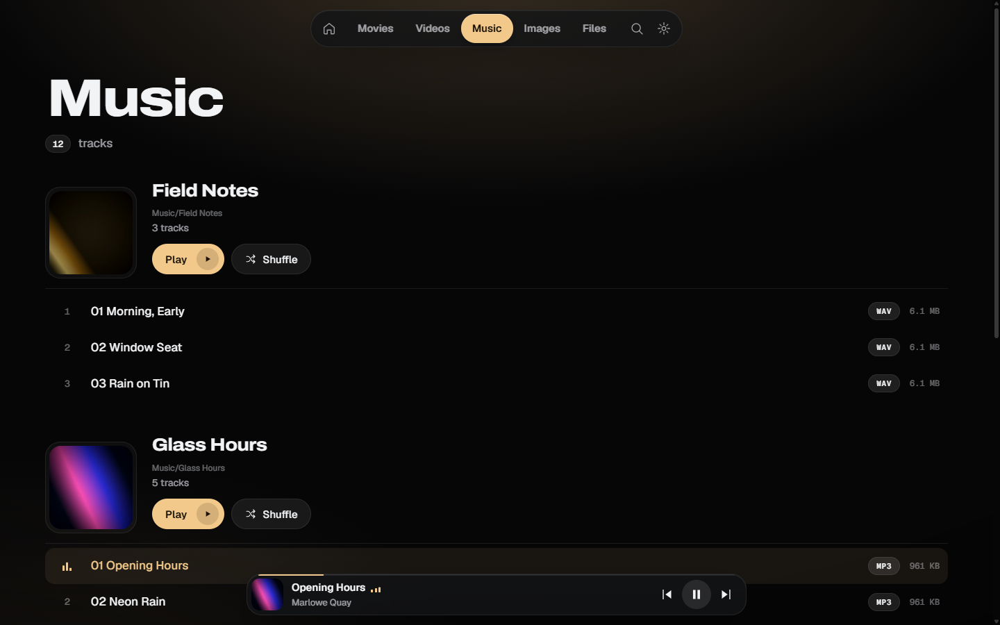
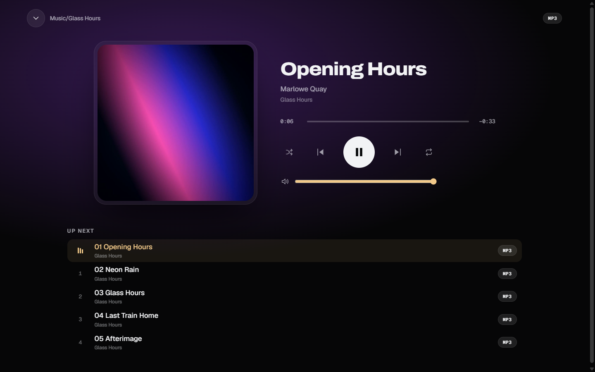
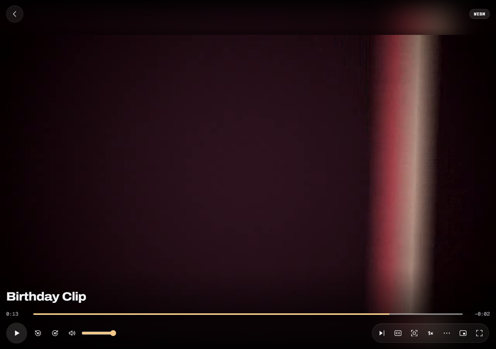

  

  Cinelan turns the PC that holds your library into a private streaming room for every screen on your wifi: phones, TVs, tablets and other computers. 
  One Python file. No accounts, no cloud, nothing to install on the other devices.

<h2></h2>

You need two things on the PC that holds your files:

- **Python 3.8 or newer.** The folder picker uses Tk, which comes with the Windows installer.
- **ffmpeg.** It makes thumbnails, plays MKV files, reads subtitles and converts the few formats a browser can't play. Install it with `winget install Gyan.FFmpeg` on Windows, `brew install ffmpeg` on macOS, or `sudo apt install ffmpeg` on Linux.

Then:

1. Download or clone this repository.
2. Run `python start.py`. On Windows you can double-click it.
3. Pick the folder that holds your movies, music and photos.
4. Open the link it prints, on any device on the same wifi.

  

The address is found for you. Cinelan uses port **6767** when it is free and a random free port when it is not, and the link on screen always has the right one.

| Command | What it does |
| --- | --- |
| `python start.py` | Opens a window to pick the folder |
| `python start.py "D:\Movies"` | Serves that folder straight away |
| `python start.py "D:\Movies" 8080` | Asks for port 8080 (falls back to a free one if it is taken) |

Press Ctrl+C or close the window to stop it. Cinelan only works while that window is open and the PC is on.

> **Good to know:** anyone on your wifi who has the link can see the folder you picked. There is no login, so use it on a network you trust.

<h2></h2>

Five rooms, sorted for you from the file types in your folder:

| Room | What lands there |
| --- | --- |
| **Movies** | Every `.mkv` file |
| **Videos** | MP4, M4V, MOV, WEBM, AVI, WMV, FLV, MPG, M2TS, 3GP and OGV |
| **Music** | MP3, FLAC, WAV, M4A, AAC, OGG, Opus, WMA, AIFF, APE, ALAC and WavPack, grouped into albums by folder |
| **Images** | JPG, PNG, GIF, WEBP, BMP, AVIF, SVG, HEIC and TIFF, with a full-screen viewer |
| **Files** | Everything, in a folder browser. Tap any file to download it to the device |

The home screen remembers where you stopped: **Resume** picks a film up where you left it, and **Continue watching** appears at the top of the Movies and Videos pages.

<h2></h2>

Music keeps playing while you move around the app, so you can browse photos or pick a film while a record runs.

<table>
  <tr>
    <td width="50%"></td>
    <td width="50%"></td>
  </tr>
</table>

- **Plays natively, at full quality:** MP3, FLAC, WAV, M4A, AAC, OGG and Opus, with instant seeking.
- **Converted on the fly by your PC:** WMA, AIFF, APE, ALAC and WavPack, as 320 kbps MP3.
- **Artwork and tags:** cover art comes from the file, or from `cover.jpg` or `folder.jpg` next to the songs. Title, artist and album come from the file's tags.
- **Now Playing:** tap the dock for large artwork, a scrubber, shuffle, repeat and the Up next queue. Swipe down or press Esc to put it away.
- **Remembers:** your queue, position, shuffle and repeat survive a reload.
- **Background and lock screen:** on Android it keeps playing with the screen off, with controls on the lock screen. Starting a film pauses the music.

<h2></h2>

  

- **Audio and subtitles:** pick any audio track. Subtitles come from inside the file, from an `.srt` or `.vtt` beside it, or from your device, with adjustable delay and size.
- **Chapters and resume:** chapters get their own menu, and the player remembers where you stopped.
- **Zoom:** **Fit**, **Immersive** (bars halved, a gentle crop), **Fill screen** or **Stretch**, to deal with the black bars on widescreen films. Pinch to zoom on a phone.
- **Also:** seek-bar frame previews, speed from 0.5x to 2x, A-B loop, picture in picture and automatic next episode.

**Ambient light.** The film lights the room around it. Open the Zoom button, then Ambient light.

| Preset | Look |
| --- | --- |
| Spill | The whole frame, softened, spilling past the picture (default) |
| Mirror | The picture's edges reflected into the black bars |
| Edge | Only the colours along the edges, like a backlit TV |
| Theatre | A dim, wide wash, closest to a real cinema |
| Vivid | Bold colour with a tight spill |
| Custom | Your own style, intensity, softness, colour, size and follow speed |

Ambient light is switched off on TVs to keep them fast.

<h2></h2>

Open the same link in the TV's browser and Cinelan adapts: larger text, safe margins and a clear focus ring. TVs are detected automatically; if yours is not, open the link once with `?tv=1` on the end.

- **Remote control:** the arrow keys move between cards and buttons, OK selects and Back goes back. Play, pause, fast-forward and rewind keys work in the player and for music.
- **Android:** double-tap the left or right side of the picture to skip 10 seconds, tap once to show or hide the controls, pinch to zoom, and swipe photos sideways to browse or down to close.
- **iPhone and iPad:** open the link in Safari, then Share and Add to Home Screen for an app icon.

<h2></h2>

| Problem | Fix |
| --- | --- |
| A TV or phone cannot open the link | Both must be on the same wifi as the PC. On Windows, allow Python through the firewall for **private networks** when it asks. |
| The link stopped working after a restart | The PC's address can change. Use the link `start.py` prints each time. |
| Thumbnails, MKV or subtitles do not work | ffmpeg is missing. Install it and restart `start.py`. |
| The picture is black but there is sound | The film is HEVC or 10-bit. Turn on the lightning button (compatibility mode) in the player. |
| The page says it cannot find its files | Keep `index.html`, `app.css`, `app.js`, `start.py` and the `assets` folder together. |
| Nothing animates | Windows has "Animation effects" switched off. Add `?motion=1` to the link, or turn the setting on. |

**Limits worth knowing**

- Seeking in converted files (AVI, WMA and similar) restarts the conversion, so it takes a moment.
- Songs do not play gaplessly, so albums that flow from track to track may have a short gap.
- Cinelan is designed for Chromium-based TV browsers and modern phones. It has not been tested on specific TV models.
